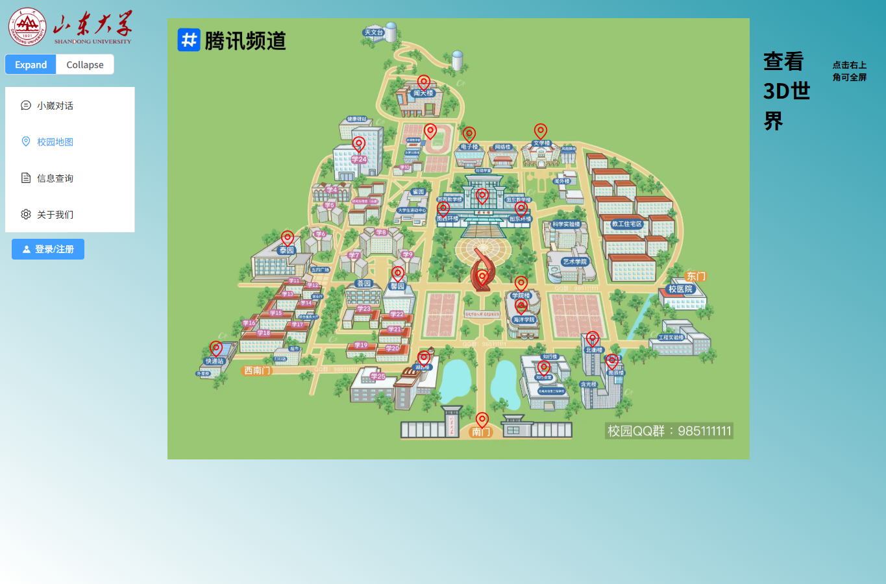
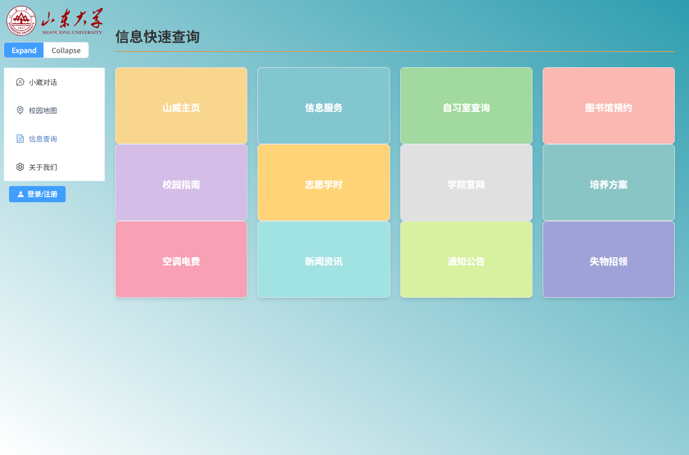

# AI 小崴 · 智能校园助手

**校内项目成果 · 2024.11—2025.01**

面向高校师生的智能校园服务项目，集成 RAG 校园问答、图片提问、校园地图、信息查询入口、用户登录和聊天记录。

本仓库从原始项目压缩包整理而来。**保留原前端页面、素材和后端业务实现**，改动限于目录整理、依赖说明、环境配置和必要的路径适配。

前端：**Vue 3 + Pinia + Element Plus + Vite**。后端：**FastAPI + MySQL / PyMySQL + LangChain + m3e-small + FAISS**，通过兼容接口调用原项目使用的大模型服务。


## 项目功能

| 模块 | 原项目实现 |
| --- | --- |
| 校园问答 | m3e 文本向量、FAISS 检索、校园资料上下文与模型回答 |
| 对话交互 | 流式输出、Markdown、图片上传与多模态提问 |
| 模型工具 | 模型选择校园、天气、时间工具；联网开关接入博查搜索 |
| 账户和记录 | 原注册登录、头像上传、MySQL 会话历史 |
| 校园地图 | 原地图、19 处建筑图片点位和 720 校园全景 |
| 信息查询 | 原 12 个校园服务快捷入口 |
| 项目介绍 | 原关于页面和轮播内容 |

历史图片外链可能失效，原有地址和包内素材均保留，详见[素材说明](docs/ASSETS.md)。

<details>
<summary>校园地图与信息入口预览</summary>




</details>

## 仓库结构

```text
ai_xiaowai/
├── frontend/                 # 原 Vue 前端及素材
├── backend/                  # 原 Python 后端与环境配置
├── docs/                     # 整理范围、素材和运行说明
├── scripts/                  # 提交内容检查
├── .github/workflows/        # 构建、语法与仓库检查
└── LICENSE                   # MIT（项目代码）
```

## 运行

前端使用 Node.js 24：

```powershell
cd frontend
Copy-Item .env.example .env
npm ci
npm run dev
```

Linux / macOS 使用 `cp .env.example .env`。默认访问 `http://localhost:5173`，API 地址通过 `VITE_API_BASE_URL` 配置。

后端保留原 MySQL、m3e 模型和 FAISS 依赖。按[后端说明](backend/README.md)准备数据库、模型目录及知识文本，再填写后端 `.env` 并启动。模型、博查和天气密钥仅存放在后端，不能写进前端 `VITE_*` 配置。

- [前端配置及原页面说明](frontend/README.md)
- [后端安装、数据库、知识库和启动说明](backend/README.md)
- [源码整理范围与原实现边界](docs/OPEN_SOURCE_NOTES.md)

## 检查

前端构建：

```sh
cd frontend
npm ci
npm run build
```

后端语法检查：

```sh
cd backend
python -m compileall -q -l .
```

仓库根目录：

```sh
python scripts/check_repository.py
```

GitHub Actions 执行这些基础检查。语法检查不等于模型、MySQL 和第三方服务已经实际联调，完整运行需要相应环境。

## 整理与授权

不提交真实密钥、服务器证书、数据库、原私有知识资料、模型权重、旧索引、依赖目录和构建产物。原来的模型、联网与天气业务代码继续保留，凭据由使用者配置。

项目代码使用 [MIT License](LICENSE)。原字体、图片、学校标识和依赖保持各自权利归属，见[素材说明](docs/ASSETS.md)。原源码中曾出现的有效凭据建议轮换。

这是校园项目原实现；登录及记录接口保留其原设计，不包含新写的权限体系。欢迎按[贡献说明](CONTRIBUTING.md)提交范围明确的改进。
