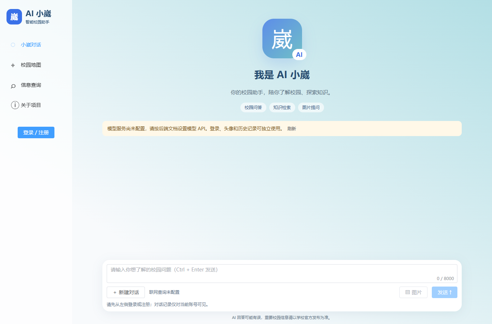
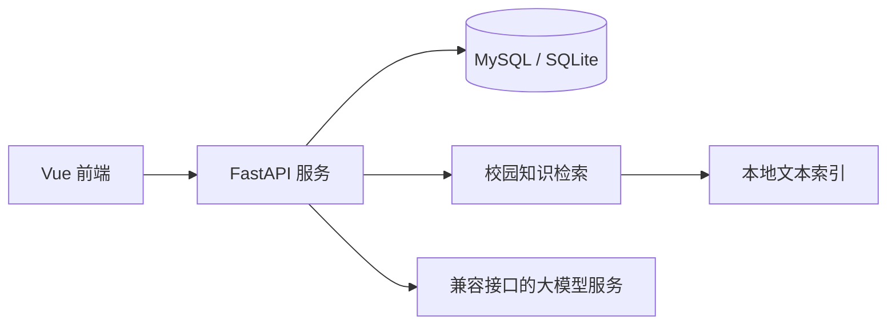

# AI 小崴 · 智能校园助手

面向高校师生的校园服务项目，整合校园问答、知识检索、地图展示与信息入口。

**校内项目成果：2024.11—2025.01。** 本仓库由历史前后端压缩包整理而来，保留主要界面和交互流程，补充可复现的本地配置、账户认证、数据库结构和开发文档。

前端使用 **Vue 3 + Pinia + Element Plus + Vite**；后端使用 **FastAPI + SQLAlchemy + MySQL + LangChain**，本地开发可直接使用 SQLite。大模型通过兼容 Chat Completions 的接口接入，密钥由部署者自行配置。



## 功能与范围

| 模块 | 当前能力 | 配置或边界 |
| --- | --- | --- |
| 智能问答 | 流式对话、Markdown 渲染、图片上传与多模态请求 | 需要配置大模型服务；图片问答还需服务支持视觉模型 |
| 校园知识检索 | 文本分块、可重建索引、检索上下文用于回答 | 默认离线字面检索，m3e 语义检索可选；实际校园资料需自行导入 |
| 账户与历史 | 注册、登录、头像、会话列表与历史记录 | 密码哈希存储，令牌认证，按用户隔离资源；未实现角色管理 |
| 校园地图 | 地图展示入口 | 可配置地图及全景内容，未实现路线规划 |
| 信息查询 | 校园信息的快捷入口 | 外部系统独立提供服务，不包含教务或课表数据库 |
| 天气、联网搜索 | 显示未接入状态 | 原第三方凭据与服务未随仓库发布 |

未配置模型密钥时，可以启动前后端、查看页面、注册登录；问答接口会明确提示未配置，不会生成模拟回答。

## 仓库结构

```text
ai_xiaowai/
├── frontend/                # Vue 页面、Pinia 状态与 API 客户端
├── backend/                 # FastAPI、认证、数据库与知识检索
├── docs/OPEN_SOURCE_NOTES.md # 原项目审计、排除内容及 Git 提交步骤
├── scripts/                 # 发布文件检查
├── .github/workflows/       # 前端构建、后端测试及仓库检查
└── LICENSE                  # MIT
```



## 本地启动

准备 **Python 3.12** 和 **Node.js 24**。以下是 Windows PowerShell 示例，使用两个终端分别运行。

后端：

```powershell
cd backend
python -m venv .venv
Copy-Item .env.example .env
.\.venv\Scripts\python.exe -m pip install -r requirements.txt
.\.venv\Scripts\python.exe -m app.build_index
.\.venv\Scripts\python.exe -m uvicorn app.main:app --reload --port 8000
```

前端：

```powershell
cd frontend
Copy-Item .env.example .env
npm ci
npm run dev
```

其他系统、可选依赖和详细配置见：

- [后端安装、模型配置、知识库构建与接口说明](backend/README.md)
- [前端安装、环境变量与地图配置](frontend/README.md)

默认前端地址为 `http://localhost:5173`，后端为 `http://localhost:8000`，接口文档为 `http://localhost:8000/docs`。复制各目录的 `.env.example` 后按需填写；所有真实 `.env` 均被 Git 忽略。前端的 `VITE_*` 配置会进入浏览器代码，只能放公开地址，不能放模型密钥。

默认数据库供本地演示使用。连接 MySQL 时使用一个空数据库，按后端说明配置连接地址；整理版不会迁移原服务器数据。

## 验证

前端：

```sh
cd frontend
npm ci
npm test
npm run build
```

后端，在已激活的 Python 虚拟环境中：

```sh
cd backend
python -m pip install -r requirements-dev.txt
python -m pytest -q
```

仓库根目录：

```sh
python scripts/check_repository.py
```

GitHub Actions 已配置相同的基础检查；真实模型调用、MySQL 部署及校园外部服务需在各自环境中验证。

## 开源整理

原始 ZIP 已按项目所有者要求删除，不进入 Git。依赖目录、构建产物、服务器证书、真实凭据、模型权重、旧索引及授权未明的素材均不属于发布内容。原知识资料可能包含个人信息，使用新编写的演示资料替代。

原包中曾存在真实凭据，仍有效的密钥、数据库口令和服务器私钥建议在服务端轮换。详细变更与首次推送命令见[整理说明](docs/OPEN_SOURCE_NOTES.md)。

## 许可证与贡献

代码使用 [MIT License](LICENSE)。第三方依赖及自行导入的模型、校园资料、图片和地图保留各自的授权条件。欢迎按[贡献说明](CONTRIBUTING.md)提交问题或改进。
